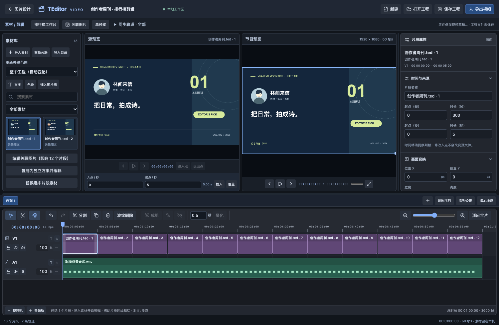
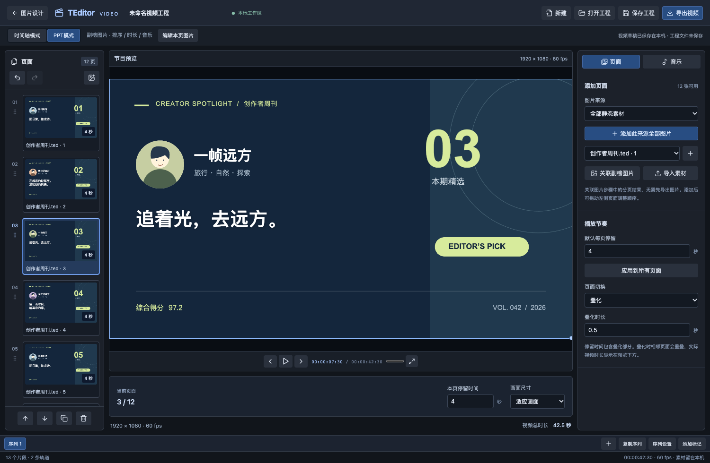

# TEditor2

[在线使用](https://teditor2.pages.dev) · [GitHub 仓库](https://github.com/SkiTiSu/TEditor2)

TEditor 的纯浏览器版本，优先支持桌面 Chrome / Edge。文字、图片、图形、表格变量、条件组与批量 PNG 都在浏览器本地处理，无需业务后端；视频工作区在此基础上提供多轨剪辑和排行榜编排，图片方案可直接进入视频流程。本仓库仅包含新版 Web 实现，不包含旧桌面项目源码，不再提供旧命令行调用。

视频首版位于 `codex/ranking-video-editor` 分支，在线站点是否包含这些功能取决于部署版本。目标是简洁的本地视频编辑器，采用素材库、源预览、节目预览与时间线的操作习惯，并不等同于 Premiere / 达芬奇的完整功能。需求和验收范围见 [`docs/VIDEO_EDITOR_REQUIREMENTS.md`](docs/VIDEO_EDITOR_REQUIREMENTS.md)。

包含 PPT 模式的版本已通过 454 项单元测试与 61 项 Chrome 浏览器回归；30 分钟 1080p60 合成输出此前单独验证通过，详见[验证记录](docs/VIDEO_EDITOR_MEDIA_VALIDATION.md)。



## 开发与部署

需要 Node.js 22.12 或更高版本、npm，以及桌面 Chrome；本次开发环境为 Node.js 24.15.0。

```sh
npm ci
npm run dev
```

开发地址为 `http://127.0.0.1:5173`。正式构建与本地预览：

```sh
npm run build
npm run preview
```

将 `dist/` 整个目录部署到静态 HTTPS 站点即可；构建使用相对资源路径，支持部署在子目录。生产版会注册构建生成的 Service Worker：首次联网打开并完成资源缓存后，可在同一浏览器中离线打开编辑器。开发模式不注册 Service Worker；清除站点数据会同时清除离线资源、草稿和本地素材缓存。目录写入、字体访问等浏览器能力需要 HTTPS，或本机 `localhost` / `127.0.0.1` 环境。

生产版联网刷新时优先加载服务器上的最新页面，断网时使用已缓存的完整版本。新版本缓存就绪后会接管后续请求，不会强制刷新正在编辑的页面。如果是早期缓存版本，首次升级可打开 `http://127.0.0.1:4173/?update=1` 绕过旧首页缓存，无需清除草稿或素材。

## Cloudflare Pages 部署

连接 GitHub 仓库后，选择 `main` 生产分支，构建命令填写 `npm run build`，输出目录填写 `dist`，根目录保持仓库根目录。Node.js 版本由 `.node-version` 固定为 22.16.0。无需环境密钥或业务后端。后续推送到 `main` 会自动部署。

`public/_headers` 为页面和 Service Worker 设置重新验证缓存，静态哈希资源可长期缓存。

## 图片设计与 PNG 输出

1. 新建模板，或打开旧 `.ted`；默认演示模板带有自生成的头像素材和 12 行数据。
2. 添加文字、图片、矩形或椭圆，在右侧调整尺寸、样式和效果。左侧拖动或使用按钮调整图层顺序。
3. 从 Excel 复制包含表头的区域，使用“导入数据”粘贴；也可直接选择 CSV / TSV。支持 UTF-8 和常见 GB18030 文件，保留编号前导零；当前不直接读取 `.xlsx`。
4. 在文字模板或图片地址模板中填写 `{列名}`，点击数据行切换预览。图片示例：`avatars/{编号}.png`。
5. 在“条件组”中选择受控图层，编辑表达式与各条件下的显隐。自动模式取首个匹配条件，否则使用“默认”；手动模式用于检查和调整指定条件。
6. 保存 `.ted`，然后导出当前 PNG，或批量写入所选目录 / 下载分包 ZIP。

批量导出支持起止行、`{index}` / `{列名}` 文件名变量及 X/Y 偏移。同页排版中的“额外副本数”为 `2` 时，一张图放入连续 **3 行**数据，输出画布尺寸保持不变；最后一组仅使用范围内的剩余行。同名输出会自动编号，ZIP 每包最多 50 张，运行中可取消并保留已完成结果。

批量导出窗口右侧提供实时排版预览：调整行范围、额外副本数和 X/Y 偏移即可查看结果，无需先导出。使用预览下方的左右箭头切换输出页，查看对应数据行及最后一页；预览与 PNG 导出共用变量、条件组和裁切逻辑。透明区域显示棋盘格，零偏移导致副本重叠时会提示。

制作同页多条的副榜时，选中整页底图，在右侧图层属性勾选 **“整页背景（不重复）”**。背景会自动排到普通图层下方，每张输出只绘制一次，保持原坐标；白色条目底板、排名、标题等普通图层继续随数据重复。图片、文字和图形均可设为背景，支持多个背景叠加；背景中的变量和条件取本页第一行数据。背景与普通图层分别计算剪贴蒙版，背景的蒙版基础图层也应设为背景。该设置随 `.ted` 保存，旧模板默认所有图层照常重复。

快捷键：`Ctrl/Cmd + S` 保存，`Ctrl/Cmd + O` 打开，`Ctrl/Cmd + C` 复制选中图层到剪贴板，`Ctrl/Cmd + V` 粘贴图层，`Ctrl/Cmd + D` 直接创建副本，`Ctrl/Cmd + Z` 撤销，`Ctrl/Cmd + Shift + Z` 重做，`Delete/Backspace` 删除，方向键移动 1 像素、`Shift` 加速至 10 像素。复制保留样式、变量和条件组，可粘贴到另一模板；外链素材仍需本机可访问。空格拖动画布，`Alt + 滚轮` 缩放；输入框内保留正常文字编辑行为。

## 视频剪辑与排行榜制作

点击图片工作区顶部的 **“视频剪辑”** 进入视频工作区；点击 **“图片设计”** 返回。图片编辑、旧 `.ted` 和 PNG 导出继续保留。视频工作区分为 **“时间轴模式”** 和 **“PPT模式”**：时间轴提供素材库、源预览、节目预览、属性区和多轨剪辑；PPT 用页面卡片快速制作副榜视频。

1. 在图片工作区准备主榜卡片、副榜排版及数据，进入视频工作区后点击 **“关联图片”**。可以使用当前一张、每行一张或按重复排版生成的分页，并选择要加入的图片。这里保存的是可重新渲染的图文方案，无需先导出 PNG。
2. 使用 **“导入素材”** 或 **“导入目录”** 添加本地视频、音频与静态图片。在素材库选择视频，在源预览播放、逐帧定位并设置入点、出点；点击 **“插入”** 或 **“覆盖”**，也可将素材拖入指定轨道。带声音的视频默认生成关联的视频和原声音频片段。
3. 自由剪辑时，上方画面轨覆盖下方画面轨；声音独立成轨。拖动片段移动，拖动两端裁切；可分割、复制、多选成组、解除编组或解除音视频关联。普通删除保留空隙，波纹删除关闭相应时间区间；锁定轨道发生冲突时会阻止编辑并提示。可调整位置、尺寸、旋转、裁切、透明度、音量及淡入淡出。
4. 批量制作时打开 **“排行榜工作台”**，先为主榜条目绑定视频选段，再设置节目模板。章节可以增删、排序，选择图片方案、条目范围及正序/倒序，组合主榜、副榜、片头、推荐段和 STAFF 等内容。预览编排的轨道数、片段数与时长后，生成一条新序列；生成结果仍是普通片段，可继续修改，不覆盖旧序列。
5. 主榜可选 **窗口式** 或 **交替式**。窗口式将图片背景、视频窗口和可选透明前景分别放在轨道上；不透明整页图应放在视频下方，前景需要保留透出视频的透明区域。交替式先显示完整卡片，再播放全屏选段；卡片停留时间可调整，视频使用手动选定的入出点和原声。
6. 副榜沿用图片阶段的“额外副本数 + 1 条/页”、X/Y 偏移和整页背景规则，尾页保留剩余条目。模板可设置每页停留时间和页间叠化，BGM 在同一副榜章节内跨页连续播放。音乐过短时可选择循环；关闭循环则播放一次，剩余时间静音。生成后可在独立音轨上追加下一首音乐、裁切或混音。
7. 使用序列标签分别编辑 SV 榜、国产榜等内容；每条序列可以独立设置画幅、帧率，支持新建和复制。点击 **“导出视频”**，先选短区间并执行 **“导出前检查”**，确认画面和声音后再导出整条序列。

时间线支持吸附、缩放、滚动、章节标记和撤销/重做。常用视频快捷键：`Space` 播放/暂停、源预览内 `I` / `O` 设置入出点、`V` 选择、`C` 剃刀、`Ctrl/Cmd + C` 复制所选片段、`Ctrl/Cmd + V` 在播放头插入、左右方向键逐帧、`Delete` 普通删除、`Shift + Delete` 波纹删除、`Ctrl/Cmd + Z` 撤销和 `Ctrl/Cmd + Shift + Z` 重做。输入框内保留正常文字编辑行为。

素材库提供删除按钮；在素材库选中素材后按 `Delete/Backspace` 删除素材，时间轴焦点下则删除片段。使用中的素材会先显示影响的序列、片段与主榜绑定数量，确认后统一移除引用；锁定轨道会阻止删除。操作可撤销，不删除磁盘原文件。

音频波形在后台连续解码生成，保留短峰值与静音，每秒最多 100 个峰值、每份素材最多 180,000 个峰值。时间轴按可见像素绘制连续包络，缩放、裁切和循环会同步显示；旧素材在本机文件可用时自动更新波形。

拖动面板之间的分隔线可调整素材区、属性区宽度和时间线高度。工作栏的 **“同步轨道”** 默认选择全部轨道；自定义勾选范围后，插入与波纹删除按该范围调整后续内容。操作涉及关联音视频时仍需同时包含关联轨道，否则会提示冲突，避免声音与画面被无意错开。

通过 **“编辑关联图片”** 返回图片工作区修改标题或样式，相关视频画面会更新，剪辑时间和声音设置保留。图片方案使用稳定的数据行 ID：排序不会把已绑定作品换到另一行；删除被引用的数据行会留下明确的缺失引用，需要处理后才能导出。一个方案被多个片段使用时，编辑会影响这些片段，请留意入口显示的影响数量。

如果只想制作变体，选择 **“复制为独立方案并编辑”**。它会新增独立的图片方案和关联图片，旧片段继续使用原方案；回到视频工作区后，可把需要改动的片段替换为副本素材。

时间轴复制支持多选，会一并复制关联音视频和编组成员，保留相对位置、源入点、样式和所选片段之间的转场。粘贴生成独立的新片段，最早片段对齐播放头，并同步后移后续内容；可撤销/重做。播放头可移动到最后一帧之后进行末尾粘贴。可在同一工程、相同帧率的不同序列间粘贴，按同类型轨道顺序对应；锁定轨道、缺失素材或转场内无法安全插入时会提示，不会部分修改工程。输入框仍使用普通文字剪贴板。

### PPT 模式：快速导出副榜视频

1. 进入视频工作区，点击 **“PPT模式”**，再点击 **“关联副榜图片”**。默认读取图片步骤的分页结果，保留重复排版、数据范围和整页背景，无需先导出图片。也可导入本地图片，或从已有图文方案中添加页面。
2. 左侧拖动页面卡片排序，或用上下移动按钮；支持复制、删除和撤销。设置 **“默认每页停留”** 后点 **“应用到所有页面”**，也可选中一页单独调整。硬切和叠化均可使用；叠化会重叠相邻页面，预览下方显示实际视频总时长。
3. 切到右侧 **“音乐”**，选择已导入的背景音乐，设置音量、循环和淡入淡出。音乐跨页连续播放；关闭循环后，音乐播放完的剩余部分静音。
4. 用中央预览检查页面与声音，点击 **“导出视频”** 生成 MP4。当前页面的图文可用 **“编辑本页图片”** 返回图片工作区修改，回来后更新画面。

两种模式共用同一条序列，切换本身不改动内容；可随时回时间轴调整图层和声音。包含视频、多层画面、多段声音或不规则间隙的复杂序列，在 PPT 中保留预览并说明限制，点击 **“新建PPT序列”** 可另建副榜，原序列保留。页面设置、音乐和顺序随 `.tevideo` 与本机草稿保存。

PPT 快捷键：左右方向键切页、`Space` 播放/暂停、`Ctrl/Cmd + D` 复制页、`Delete/Backspace` 删除页、`Ctrl/Cmd + Z` 撤销。输入框内仍按正常文字编辑处理。



### 视频工程、模板与素材恢复

| 文件 | 保存内容 |
| --- | --- |
| `.ted` | 原有图片模板和选择内嵌的静态图片；用于图片设计 |
| `.tevideo` | 视频工程、图片与数据快照、资源索引、多序列、片段、转场及主榜选段绑定 |
| `.tevt` | 可复用的排行榜编排规则；每一期在工作台重新选择图文来源、视频和音乐 |

**“保存工程”** 下载 `.tevideo`；模板既可下载为 `.tevt`，也可存入工程。自动草稿与原始媒体分别保存在当前站点的 IndexedDB，剪辑时不会反复重写整批视频。图文方案的外链图片和导入字体有独立资源引用，同名文件不会仅凭文件名覆盖另一方案。

`.tevideo` 是轻量工程文件，不是包含所有视频、音频、外链图片和字体的素材包。请同时保留原始素材目录。重新打开时会尝试使用本机缓存；素材失联后点击 **“重新关联”** 选择原目录，按路径和文件信息恢复，重名冲突需明确处理。旧图片模板仍可在图片工作区通过 **“关联素材目录”** 恢复外链图片。浏览器无法仅凭工程记录的磁盘路径读取文件，也不会跨设备自动同步。清除站点数据、浏览器配额回收或无痕会话结束可能使缓存失效。

遇到同名素材的多个版本时，先在 **“重新关联范围”** 选择具体素材或图文方案，再选择对应目录。文件大小或修改时间不符时会拒绝自动关联；确实要换素材，应作为新文件导入后明确替换，保留原工程引用。

### 视频输出与浏览器边界

输出为 MP4（H.264 视频 + AAC 音频），跟随当前序列的画幅和帧率，可设置导出区间与视频码率。**“选择文件并导出”** 将数据逐块写入所选文件；**“生成后下载”** 先写入浏览器临时文件，完成后提供下载。导出可以取消，取消后工程仍可继续编辑；保持页面打开，关闭页面后不支持接续编码。

模板和序列统一支持 **1–240 fps**（可输入小数，含 23.976 / 29.97 / 59.94），导出直接跟随序列帧率。模板生成新序列时使用模板帧率；更改现有序列帧率会按时间重新计算剪辑边界，过短片段无法保留时提示修正。高分辨率与高帧率的组合仍须通过本机编码能力检查。

视频默认使用 **VBR 可变码率**，1080p 为 **6 Mbps**；720p 及以下为 3 Mbps，4K 为 20 Mbps，更大画幅为 40 Mbps。可手动改为其他目标值，或选择 **CBR 恒定码率**。静态副榜画面在 VBR 下可能只需很低的实际码率，复杂画面则可能超过目标，目标并非码率上限；CBR 请求也可能被设备编码器忽略。完成后会提示明显高于目标或明显偏离 CBR 目标的结果。完成后显示目标码率与实际平均视频码率，后者按编码视频包计算，不包含音频与 MP4 容器开销。

1080p 的 6 Mbps 参考 B 站创作中心 [2018 年清晰度规则补充说明](https://www.bilibili.com/read/cv527957/)；这属于历史公开规则，**不能保证当前平台免二压**，其余分辨率档位是应用默认值。实际投稿处理以平台当前规则为准。

导出区间、码率和码率模式按序列记忆。关闭包含有效设置的导出窗口，或执行检查/导出后，这些设置会写入工程；再点击 **“保存工程”** 可带到下次打开。时间线缩短后，再打开导出窗口会把旧范围限制在新的序列时长内。

优先使用桌面 Chrome / Edge，通过 HTTPS 或本机地址运行。能否解码源文件、编码 H.264/AAC 取决于浏览器、操作系统和设备实际提供的 WebCodecs 能力；文件扩展名本身不能保证可用。应用会检查编码能力、素材和截取范围等条件，缺少所需能力时会提示原因。直接写入和临时文件方式也各自需要浏览器文件系统支持及可用空间。

**1920×1080、60fps、30 分钟**合成节目已完成真实长片验证：108,000 帧，H.264 + AAC，音视频时长均 1,800 秒，本机导出约 6 分 35 秒。测试使用短源视频循环，实测条件、输出核对和内存边界见 [`docs/VIDEO_EDITOR_MEDIA_VALIDATION.md`](docs/VIDEO_EDITOR_MEDIA_VALIDATION.md)。实际速度和内存占用取决于源编码、轨道数量、图文复杂度及设备；不承诺实时导出或所有设备均达到同样性能。建议先用自己的素材导出短样片，核对文字、裁切、声音和转场，再处理整期视频。关键帧动画、变速、代理素材、自动响度、高级调色、多机位、嵌套序列和完整素材打包不在当前首版范围内。

## 旧版 GUI 功能清单

| 范围 | Web 实现 |
| --- | --- |
| 文档与模板 | 新建、尺寸设置、打开 / 保存、修改提示、版本校验、本机草稿恢复 |
| 图层 | 文字 / 图片 / 矩形 / 椭圆；选择、重命名、移动、缩放、复制、删除、排序、显隐 |
| 编辑历史与画布 | 撤销 / 重做、操作历史、方向键微调、缩放、平移、适应画布 |
| 文字排版 | 字体、字重、斜体、左右 / 居中 / 两端对齐、行高、旧版细空格间距、固定文本框换行与省略 |
| 文字效果 | 内侧 / 外侧 / 居中描边、阴影距离 / 角度 / 模糊 / 透明度 |
| 图片与图形 | 本地图片、模板内嵌图片、变量图片路径、尺寸调整、填充、边框、独立圆角与联动 |
| 剪贴蒙版 | 按下方基础图层的透明度剪贴，支持文字、图片和图形蒙版 |
| 表格与变量 | Excel 粘贴、CSV / TSV 文件导入、逐行预览、单元格编辑、增删行、排序与分页 |
| 条件组 | 新增 / 删除 / 命名 / 颜色、表达式、优先级、默认条件、受控图层和逐条件显隐、自动 / 手动预览 |
| PNG 输出 | 当前图、批量图、文件名模板、行范围、同页副本偏移、透明背景、目录写入、分包 ZIP、进度和取消 |

## 模板、字体与素材兼容

- 可导入旧 **VersionCode 0** 文件；新保存的模板使用 **VersionCode 1** 和 CSS 颜色格式。此兼容方向是 Web 读取旧模板，不保证旧桌面程序可以读取新版文件。
- 旧版 WPF 的颜色、字体字重、枚举、图层顺序和条件字段会转换；未知图层 / 文件版本会报告错误，避免无提示丢失内容。
- 旧绝对路径如 `D:\素材\avatars\001.png` 需要通过“关联素材目录”重新选择本机目录。优先匹配相对路径，同名文件存在歧义时会提示。浏览器不会仅凭模板中的路径直接访问磁盘。
- 字体可通过“读取本机字体”授权访问，或导入 TTF / OTF / WOFF / WOFF2。缺失字体、系统字体差异和 WPF / Canvas 排版差异可能改变字形、换行或描边边缘；应使用实际模板检查重要输出。
- 图层属性中点击字体右侧箭头可展开完整字体列表，按名称搜索和选择；搜索不会修改当前字体。每次打开页面都会检查字体权限，已授权时自动重新读取本机字体，未授权时不自动弹窗。上次读取的名称仅作加载期间或读取失败时的备用列表；页面打开期间安装或卸载字体后，可在列表内重新读取。字体家族会去重，粗细和斜体仍在各自属性中选择。
- 条件表达式使用本地解释器，兼容旧 ToolGood v2 的常用语法，并用上游回归样例验证。复杂、少见或版本特定的公式仍需要实际模板验证；不支持的函数和公式错误会显示提示，不承诺所有表达式逐项等价。实现与样例来源见 [`src/vendor/toolgood/README.md`](src/vendor/toolgood/README.md)。
- PNG、JPEG 等浏览器支持的格式可以直接使用；TIFF 提供首帧解码。内嵌图片支持 `data:` URL 和旧加载器接受的原始 Base64。

草稿、表格、素材和导入字体保存在当前浏览器站点的 **IndexedDB**。它们不会跨设备同步，也不能替代 `.ted` 文件备份；浏览器清理、配额限制或无痕会话结束可能使缓存失效。`.ted` 保存模板及选择内嵌的静态图片；表格源文件和变量图片目录请另外保留。

## 自生成验证数据

- [`public/examples/legacy-all-features.ted`](public/examples/legacy-all-features.ted)：合成的旧版模板，包含四类图层、内嵌 PNG、半透明颜色、文字效果、圆形蒙版、变量和 VIP 显隐条件。
- [`public/examples/legacy-data.csv`](public/examples/legacy-data.csv)：与该模板配套的 12 行数据，列为 `姓名`、`城市`、`编号`、`等级`。先打开模板，再导入 CSV，即可检查逐行内容和 VIP 条件变化。
- 默认演示的 SVG 头像、人物名称和表格数据由项目代码生成；验证用 PNG 也为程序生成，不依赖远程素材。
- [`public/examples/secondary-ranking.ted`](public/examples/secondary-ranking.ted) 和 [`public/examples/secondary-ranking.csv`](public/examples/secondary-ranking.csv)：自生成的紫色渐变副榜。先打开模板并导入配套 CSV，再设置额外副本数 **3**、X 偏移 **0**、Y 偏移 **250**，即可预览每页四条榜单，第二页仅剩一条，整页背景均保持完整。

## 测试

```sh
npm test
npm run test:e2e
```

浏览器测试使用本机 Chrome 的无头模式，自动启动或复用 `127.0.0.1:5173` 的开发服务器，并构建 / 启动 `127.0.0.1:4173` 的生产预览服务。若系统没有 Chrome，先安装 Chrome，或修改 `playwright.config.ts` 的 `channel` 并安装对应 Playwright 浏览器。

| 文件 | 验证内容 |
| --- | --- |
| `tests/document.test.ts` | 旧格式 / 颜色 / 枚举、保存重开、图层复制隔离、错误文件和画布尺寸 |
| `tests/data.test.ts` | CSV / TSV、变量替换、条件求值、ToolGood v2 回归样例、批次与文件名 |
| `tests/render.spec.ts` | 图层顺序、圆角、透明度蒙版、文字锚点 / 描边 / 阴影 / 换行、过时渲染覆盖保护 |
| `tests/assets.spec.ts` | Windows 路径重关联、同名歧义、素材替换竞态、缓存上限、浏览器恢复和演示出图 |
| `tests/editor.spec.ts` | 完整界面操作、快捷键、拖拽缩放、条件组、旧模板与表格导入、保存重开、PNG / ZIP、本机草稿 |
| `tests/offline.spec.ts` | 生产构建首次缓存后断网刷新、编辑和导出 |
| `tests/export.spec.ts` | 500 张 1080p PNG、范围与副本像素、重名保护、ZIP 分包、取消和写入失败 |
| `tests/batch-preview.spec.ts` | 实时副本偏移、逐页数据与条件组、预览 / PNG 逐像素一致、无数据、无效范围及小窗口布局 |
| `tests/page-background.spec.ts` | 整页背景只绘制一次、半透明与蒙版、首行变量、开关与撤销、保存重开、四行副榜及尾页的预览 / PNG 逐像素一致 |
| `tests/fonts.spec.ts` | 500 个字体家族的完整列表、去重、搜索选择、刷新恢复、重新读取、拒绝授权和损坏缓存 |
| `tests/video.test.ts` | 工程保存重开、稳定行身份、图文资源隔离、关联音视频编辑、锁定冲突、模板编排与转场时序 |
| `tests/video-editor.spec.ts` | 图片/视频工作区衔接、时间线交互、模板生成、工程恢复及失败路径 |
| `tests/video-recovery.spec.ts` | 损坏草稿恢复失败后的原数据保留，以及显式新建后恢复自动保存 |
| `tests/video-media.spec.ts` | 实际媒体编码/解码、音画同步、图文合成、导出取消与长片验证 |
| `tests/layer-clipboard.test.ts` / `tests/layer-clipboard.spec.ts` | 图层复制粘贴、跨文档条件组、系统快捷键与普通文字剪贴板 |
| `tests/video-clipboard.test.ts` / `tests/video-clipboard.spec.ts` | 时间轴多片段复制粘贴、关联音视频、插入后移、转场、锁定保护与原生剪贴板 |
| `tests/video-workflow.test.ts` / `tests/video-workflow.spec.ts` | 素材删除焦点、跨序列引用、撤销、密集波形与短促峰值 |
| `tests/video-settings.test.ts` / `tests/video-encoding.spec.ts` | 帧率一致性、切点换算、6/40 Mbps 实际编码、CBR、240 fps MP4 和设置保存 |
| `tests/slideshow.test.ts` | PPT 页面排序、时长、转场、BGM、导出范围和复杂序列保护 |
| `tests/video-slideshow.spec.ts` | 副榜分页直连、PPT/时间轴一致性、保存恢复、实际 MP4 画面与循环音乐 |

单独运行批量基准：

```sh
npm run test:e2e -- tests/export.spec.ts --grep "exports 500 real"
```

该用例实际逐张渲染并编码 **500 张 1920×1080 PNG**，使用包含文字、阴影、图片、蒙版和条件组的合成模板，输出 `500-image-benchmark.json` 测试附件。它以模拟目录写入接口验证 PNG 后丢弃数据，**不包含真实磁盘写入耗时**；`performance.memory` 仅反映 **JavaScript 堆**，不包含原生 Canvas、图片解码器或 PNG 编码器全部内存。耗时受设备和模板复杂度影响，不能将该结果当作所有模板的速度或峰值总内存保证。

文档像素总量限制为 6400 万；批量采用逐张绘制、编码与写入，避免同时保留整批未压缩画布。运行大批次时保持页面打开。

第三方运行依赖的许可证随构建写入 `dist/THIRD_PARTY_NOTICES.txt`。ZIP 分包临时存放在浏览器私有文件系统，以减少整批导出时的内存占用。
