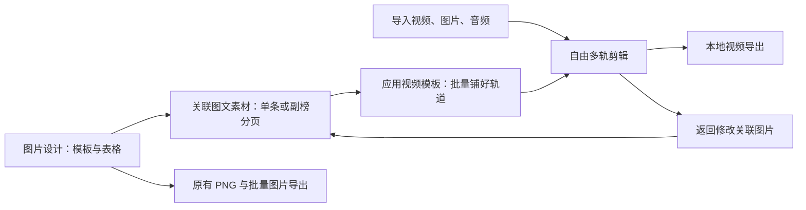

# TEditor2 视频编辑需求方案

版本：实施稿 v0.2 · 2026-10-24

工作分支：`codex/ranking-video-editor`

当前状态：首版已实现并完成本机验证。生产构建与 422 项单元测试通过；最终 Chrome 全量回归 57 项通过（常规运行跳过的长片项已单独完成）。30 分钟、1080p60、108,000 帧有声 MP4 合成测试通过。详细条件、用时、输出核对与局限见 [验证记录](VIDEO_EDITOR_MEDIA_VALIDATION.md)，界面见 [实际截图](video-editor-preview.png)。这些结果不代表所有设备和所有源编码均已覆盖。

一期目标是保留图片编辑能力并完成可自由调整的排行榜视频工作流。Premiere / 达芬奇仅作为素材、双预览和时间线操作的参考，不宣称达到其完整编辑、调色、特效或音频制作能力。已确认方向和一期验收要求保持有效；以下后续范围只包含原计划列出的增强能力，不用来替代未完成的首版要求。

## 1. 产品目标与已确认方向

在保留现有图片编辑器全部能力的基础上，扩展为支持自由多轨剪辑的 Web 视频编辑器。以 Premiere 式素材区、源预览、节目预览、属性区和时间线为主要操作模型，提供排行榜专用模板和批量编排，缩短每一期节目的制作过程。

已确认：

- 现有图片模板、变量、条件组、重复排版、图片导出与旧 `.ted` 兼容功能全部保留。
- 图片设计完成后，无需导出 PNG，直接进入视频流程；同一工程容纳主榜、副榜、片头等多份图片方案。
- 视频与图片等素材可自由叠放、剪辑和调整，模板生成的内容也可以自由编辑。
- 主榜同时支持“视频嵌入模板窗口”和“全屏视频与榜单图片交替”，由视频模板决定。
- 主榜主要通过界面手动选择视频、设置入点和出点。
- 默认主榜保留视频原声，副榜播放背景音乐；支持单独调整。
- 按用户认可的示例，将 1920×1080、60fps、约 30 分钟作为目标验收场景。实际工程时长由内容决定，不强制补足 30 分钟。
- 纯浏览器本地处理，无需安装配套程序，无需上传素材。优先沿用桌面 Chrome / Edge 使用范围。

具体默认值可继续调整。实现中的操作与本节方案有差异时，需要明确补齐或记录差异，不能据此自动缩减已确认的目标。

## 2. 两条入口，共用一个工程

用户可以从空白视频工程自由剪辑，也可以从当前图片方案点击“用于视频”，或选择排行榜视频模板开始。工作区随时切换，不强制按向导完成每一步。

按任务分为**图片设计 / 素材 / 剪辑 / 导出**四部分。当前首版使用“图片设计”和“视频剪辑”两个主入口：素材与剪辑同屏，导出使用独立对话框。图片设计保留现有操作；素材区管理视频、声音和关联图文；剪辑区完成时间线编辑；导出区选择参数并查看输出进度。

一个工程可包含多条命名序列，各自拥有独立的时间线、画幅和帧率，共用素材和图片方案。工程预设只提供新建序列的初始值；修改某条序列或套用模板不影响其他序列。例如同一期的 SV 榜和国产榜分别编辑、分别导出；序列标签用于快速切换。首版支持创建、复制、重命名、切换序列和逐个导出，不要求嵌套序列或批量导出队列。

## 3. 剪辑界面与操作习惯

### 3.1 默认布局

| 区域 | 内容和操作 |
| --- | --- |
| 左侧素材区 | 文件夹、视频、音频、静态图片、关联图文、模板；搜索、缩略图、缺失状态 |
| 上方源预览 | 双击素材打开，播放、逐帧、设置入点/出点、显示所选长度、送入时间线 |
| 上方节目预览 | 显示时间线最终合成画面，支持选中当前片段并拖动、缩放 |
| 右侧属性区 | 所选片段的位置、缩放、裁切、透明度、时间、音量、关联图片入口 |
| 下方时间线 | 多条视频/图文轨、多条音轨、时间尺、播放头、缩略图、波形、章节标记 |

双预览可切换为单预览以适应较小屏幕。默认布局清晰固定，面板可调整尺寸，首版不要求任意拆窗。

设计借鉴 Premiere 的源监视器与节目监视器分工、素材入出点和插入/覆盖操作；这些操作在 Adobe 的[监视器说明](https://helpx.adobe.com/premiere/desktop/get-started/source-and-program-monitor-adjustments/about-source-monitor-and-program-monitor.html)和[时间线素材插入说明](https://helpx.adobe.com/premiere/desktop/edit-projects/intro-to-editing/add-media-to-the-timeline-using-source-patching.html)中有明确描述。达芬奇也采用素材池、源片段入出点、时间线编排的流程，参考其[官方剪辑页](https://www.blackmagicdesign.com/products/davinciresolve/edit)。

### 3.2 图层与轨道

- 视频轨可以放视频、普通图片、关联图文、文字和色块；上方视频轨覆盖下方轨道，透明区域透出下方内容。
- 音频独立成轨。导入视频时默认建立关联的视频/原声音频片段，移动、裁切时保持同步，可主动解除关联。
- 可新增、删除空轨、重命名和调整轨道次序；支持轨道锁定、画面隐藏、声音静音与音轨独听。
- 不把轨道固定成“主榜轨”“副榜轨”。模板可以命名轨道，但用户可以自由使用。
- 图片内部图层继续由原图片编辑器管理。时间线中的关联图文默认是一个片段，双击可回到图片设计；不自动拆散原图层及蒙版关系。
- 需要独立运动或叠放的图文可以制作成独立图文素材或视频文字片段，再放到不同轨道。

### 3.3 首版核心剪辑动作

| 操作 | 预期行为 |
| --- | --- |
| 拖入素材 | 拖到指定轨道和时间位置；落点、长度与影响范围可预览 |
| 插入 | 在播放头插入，按选定的同步轨道范围后移后续内容 |
| 覆盖 | 替换指定轨道时间区间，保留区间外内容；操作前显示覆盖范围 |
| 移动与裁切 | 拖动片段移动，拖动两端调整长度；裁切不修改源文件 |
| 分割 | 在播放头分割选中片段；关联音视频一起分割 |
| 删除 / 波纹删除 | 普通删除保留空隙；波纹删除关闭选定范围并同步移动后续片段 |
| 多选与成组 | 多片段复制、移动、删除；生成的榜单条目默认成组，允许解除 |
| 吸附与缩放 | 吸附播放头、片段边缘和标记；时间线缩放与滚动；适应全片 |
| 替换素材 | 保留片段位置与样式；新素材过短时提示调整，不静默拉伸 |
| 撤销 / 重做 | 一次拖动、批量生成、模板套用分别形成一次完整操作 |

锁定轨道不允许被剪辑动作修改。若同步操作涉及锁定的关联片段，阻止该动作并说明冲突，避免无提示音画错位。同轨片段默认不隐式重叠；要重叠画面放到其他轨道，要覆盖或添加转场使用明确操作。

常用快捷键建议：空格播放/暂停，I/O 入出点，V 选择，C 剃刀，方向键逐帧，Delete 普通删除，Shift+Delete 波纹删除，Ctrl/Cmd+Z 撤销。键盘作用于当前聚焦的工作区，输入框内保留文字输入和原有快捷键。

## 4. 排行榜制作能力

### 4.1 图片方案直接进入视频

图片方案保存：`.ted` 模板快照、表格数据、行选择、顺序、重复数量、X/Y 偏移和版本标识。一个视频工程可以保存多份方案，例如主榜卡片、副榜整页、章节标题和片尾名单。

“用于视频”提供三种来源：当前一张、每行生成一张、按重复排版生成多页。显示页数、条目范围和缩略图，用户可以选择全部或部分页面。

这里生成的是**可重新渲染的关联图文素材**。用户不需要下载或重新导入图片。回到图片设计修改内容后，相关视频画面更新，已设置的剪辑时间、素材绑定和声音设置保持不变。

一个图片方案可被多个片段共用。编辑前显示影响的片段数量，也可“复制为独立方案”后修改。渲染缓存使用图片方案、数据、字体、素材和排版参数的版本信息失效更新。

### 4.2 主榜条目

1. 从主榜数据生成条目列表，按配置的榜单顺序显示排名、标题、图片预览与视频绑定状态。
2. 选择条目，拖入本地视频；源预览中设置入点和出点，显示截取长度和波形。
3. 套用场景模板，直接查看图文与所选片段的合成效果。
4. 点击“加入时间线”或对已完成绑定的条目批量编排。
5. 生成后每个条目都是普通轨道片段和编组，可自由拆分、重排和追加其他素材。

两种必须支持的场景：

- **窗口式**：背景图文 → 指定窗口内的视频 → 前景排名、标题或装饰。窗口支持位置、尺寸、适应/填充裁切；维持视频原始比例，禁止默认拉伸变形。
- **交替式**：完整榜单图片展示若干秒 → 全屏视频片段 → 下一条；可选择保留独立的角标/标题层。静态卡片默认不延续原声，需要时允许声音跨片段延续。

整页不透明图片不能直接充当透明前景。窗口式模板必须明确背景、视频窗口和前景三者关系，可使用带透明区域的前景或分别准备背景/前景图文；旧图片的“整页背景（不重复）”设置继续保持原来的分页含义。

建议一个条目首选一个片段，但允许同一条目添加多个镜头、标题页或独立音频。参考 CVSE 制作公告，可将 25 秒作为选段初始长度建议，不覆盖用户手动选择的出入点，也不代表所有榜单片长相同。片段越界、缺失视频和无法解码都在条目列表中定位。

### 4.3 副榜分页

- 直接沿用现有“额外副本数 + 1 条/页”、偏移、整页背景不重复、尾页不足条数的行为。
- 每一页生成一个图文片段，按顺序铺入时间线；建议默认每页 5 秒，可修改全局默认或单页时长。
- 支持页序正序/倒序、指定条目范围和手动重排，不硬编码排名数量。
- 背景音乐独立铺在音轨上，跨页连续播放；换页不会重新启动音乐。
- 背景音乐长度不足时，明确选择循环、换下一首或保持静音；循环接缝和结尾提供淡入淡出。
- 支持硬切和短叠化；实际章节时长按片段及转场占用计算，界面实时显示。

### 4.4 视频模板

视频模板保存的是可复用的**场景布局与时间线编排规则**，包括画幅、帧率、轨道、图片/视频槽位、章节顺序、条目顺序、默认时长、转场和音频规则。

| 模板层次 | 示例 | 换一期时替换什么 |
| --- | --- | --- |
| 场景模板 | 主榜窗口、主榜图片+视频、副榜整页、标题卡 | 图文来源、视频和文字数据 |
| 节目模板 | 片头、若干主榜段、副榜段、推荐段、片尾 | 本期图片方案、数据范围、各条目视频、音乐 |

模板的图片槽位既支持“一张图片”，也支持“一整组关联图片”；序列槽位自动容纳不同数量的主榜条目和副榜页。能够把图片阶段准备的全部图片按类别一次放好，并允许查看尚未使用的图片。

套用模板时先预览生成的轨道、总时长与缺失素材，再生成可编辑片段。重套模板默认创建新序列；更新已有序列需显示新增、删除和受影响的手动修改，不能直接抹掉剪辑成果。

首版提供基础排行榜模板，并参考 CVSE 增加可选的 SH、HOT、特别推荐、STAFF 和支持名单槽位。章节类型、顺序和数量可修改，主榜与副榜可以分段穿插。CVSE 参考资料及核实范围见第 11 节，实际章节规则以用户确认或可核实节目内容为准。

## 5. 画面、声音与时间规则

首版画面属性：位置、缩放、旋转、裁切、透明度、适应/填充、简单文字和色块。静态复杂图文继续使用已有图片编辑器。支持硬切、画面淡入淡出、相邻片段叠化；高级动画列入后续版本。

首版声音属性：原声开关、片段音量、音轨音量、音频裁切、淡入淡出、BGM 循环、基础波形及电平反馈。主榜默认原声开启、副榜默认 BGM 开启；用户可以跨章节铺设或自由混音。自动压低 BGM 和响度统一列入后续版本。

时间线视频时间以所属序列的帧为单位，源媒体保留自身时间戳，音频按采样时间处理。采用起点包含、终点不包含的区间规则；60fps 下 5 秒副榜页应精确占用 300 帧。混合源帧率时映射到序列帧率，避免累计音画漂移。修改序列帧率需重算该序列并显示影响。

默认叠化将前一片段末尾与后一片段开头的指定时长重叠，例如 0.5 秒叠化使两片段合计时长减少 0.5 秒，不读取用户截取区间之外的内容。若片段过短或前后转场争用同一段内容，提示缩短转场或调整截取范围，不擅自循环、定格或缩短其他段落。预览和导出共用时序规则。

## 6. 工程保存与旧功能兼容

新增独立的视频工程格式 `.tevideo` 和视频模板格式 `.tevt`，继续原样支持 `.ted`。不把时间线或视频图层硬塞进旧图片格式。

工程包含：图片方案集合、数据快照与稳定条目 ID、素材索引、序列、轨道、片段、编组、转场、声音设置、章节、导出设置和版本号。素材 ID、条目 ID、片段 ID 独立，不使用表格行号或文件名作为唯一身份。

保存策略：

- 自动草稿保存工程元数据和必要小型资源；不在每次修改时重写全部视频。
- 正式工程文件保存可恢复的编排和图片方案；大视频默认引用本地素材，重新打开时检查访问权限和文件变化。
- 素材丢失后支持选择原目录批量重新关联；同名文件冲突必须可区分。
- 首版支持轻量工程文件与素材重关联；完整便携素材打包放入后续版本，并在保存界面说明是否包含媒体。
- 返回图片工作区、切换其他模板或恢复草稿，不丢失视频工程中的其他图片方案。
- 图文方案的外链图片和字体采用资源 ID 与方案内路径索引，文件增量保存在本机。不同文件即使同名、同大小、同修改时间，也不能静默覆盖旧方案；同一个文件对象可以共享存储。资源缺失时保留索引并报告，不用当前图片工作区的同名文件替代。旧工程未提供独立资源索引时保留原素材解析兼容路径。

旧功能兼容验收包括所有现有图层效果、变量、条件组、字体、剪贴蒙版、分页重复、整页背景、PNG/ZIP/目录输出、离线打开和旧 `.ted` 导入。

## 7. 本地导出与性能目标

目标输出 MP4（H.264 视频 + AAC 音频），提供 1080p60 默认预设及画幅、帧率、质量设置，默认跟随当前序列的画幅和帧率；是否可用需在设备上检测。缺少目标编码能力时，在正式导出前显示原因与可用选项，不悄悄输出另一种格式。

当前实现使用 Mediabunny 处理媒体容器及流式读写，通过浏览器 WebCodecs 解码/编码、Canvas 逐帧合成和分块音频混合生成 MP4。WebCodecs 提供编解码接口，但不保证特定编码格式一定可用，因此必须对目标音视频配置分别检测并做实际短片验证，依据 [WebCodecs 规范](https://www.w3.org/TR/webcodecs/)；Canvas 与视频帧互操作、Worker 中逐帧处理可参考 [Chrome 官方实践](https://developer.chrome.com/docs/web-platform/best-practices/webcodecs)。容器、编码器、音频时间戳及输出文件均需要验证，不能只调用编码器就视作完成 MP4 输出。

建议的工程约束：

- 图片图文按页/版本缓存；不在每帧重新解释全部表格、加载字体和绘制静态图层。
- 视频按需解码、及时释放帧，设置队列上限和背压；导出逐块写入，不将 30 分钟未压缩帧或完整声音堆在内存。
- 低清预览和缩略图缓存与导出质量分离，预览卡顿不改变成片时序。
- 导出可取消并清理临时文件，保留工程；不把未完成文件标成成功作品。首版不承诺关闭网页后自动续传或续编码。
- 导出前检查素材、字体、截取范围、编码能力、写入权限与可用空间；允许先导出选区短样片。
- 保存工程、导入文件及新权限请求仍遵循浏览器权限机制；纯本地不等于能够绕过用户选择文件直接访问磁盘。

1080p60 / 30 分钟合成节目已完成真实导出验证，原始数据见 [VIDEO_EDITOR_LONG_RUN.json](VIDEO_EDITOR_LONG_RUN.json)，实测条件与限制见 [VIDEO_EDITOR_MEDIA_VALIDATION.md](VIDEO_EDITOR_MEDIA_VALIDATION.md)。技术验证必须记录设备、浏览器、源编码、轨道数量、成片时长、导出用时、音画同步与内存趋势；最终结果另行报告。短片、单元测试或单一设备结果均不能证明所有长片和设备适用，不承诺实时导出。

## 8. 现有代码复用与新增边界

| 现有位置 | 复用/调整方式 |
| --- | --- |
| `src/core/batch.ts` 的 `renderBatchPage()` | 直接生成副榜页和关联图文渲染结果，共用图片导出的画面规则 |
| `src/core/data.ts` 的 `planBatch()`、`resolveDocument()` | 复用分页、变量与条件解析；视频项目增加稳定条目身份 |
| `src/core/render.ts` | 继续负责图片内部图层与蒙版；新增视频合成器处理轨道叠放 |
| `src/components/BatchPreview.tsx` | 复用分页检查体验和过时渲染隔离思路 |
| `src/core/assets.ts` | 沿用相对路径与歧义检查规则；新增独立的音视频索引和缓存 |
| `src/core/storage.ts` | 图片草稿保留；视频工程增加版本化、增量持久化，不复用全量重写大文件方式 |
| `src/App.tsx` | 提取图片工作区，新增工程壳与工作区切换；逐步解耦，保留原操作 |

当前新增模块位于 `src/video/`：`model.ts` / `types.ts` 定义工程，`edit.ts` 提供时间线命令，`templates.ts` 编排榜单，`graphics.ts` 隔离图文资源，`storage.ts` 增量保存草稿与文件，`media.ts` / `compositor.ts` / `export.ts` 处理媒体与导出；`VideoEditor.tsx`、`Timeline.tsx`、`Monitors.tsx` 和 `TemplatePanel.tsx` 提供界面。PPT 模式由 `slideshow.ts` 提供页面操作，`SlideshowEditor.tsx` 提供页面卡片与音乐设置，复用同一序列模型和导出链路。播放与导出共享序列求值和合成规则，选用库后的能力、兼容性和性能仍须以验收结果为准。

## 9. 建议实施顺序

一期按下列 A–D 的共同标准实现，已完成本机自动化、真实输出及长片验证；用户操作说明见根目录 `README.md`，本节保留验收边界。

| 阶段 | 交付物 | 完成标准 |
| --- | --- | --- |
| A：媒体链路验证 | 本地视频截取、图文合成、原声+BGM、MP4 样片 | 在目标设备验证时间戳、音画同步、分块写入与长时导出可行性 |
| B：自由剪辑基础 | 工程、素材库、双预览、多轨时间线、基本剪辑和保存重开 | 从空白工程自由剪出带音频的视频，原图片工作流仍可用 |
| C：排行榜工作流 | 多图片方案、主榜手动选段、副榜分页、可编辑视频模板 | 不导出 PNG 即可完成整期节目，并逐轨自由调整 |
| D：完整首版验收 | 转场、预检、取消恢复、快捷键与兼容回归 | 完成第 10 节的真实输出验证和长片验收 |
| 后续增强 | 位置/透明度/音量关键帧、更多转场、变速、代理、自动响度、素材打包 | 根据首版使用反馈排序 |

阶段 A–D 共同构成第一版完整目标；“只有预览时间线”或“只能导出无声短片”不能视为完成。高级调色、节点特效、多机位、字幕识别和协作不列入首版。

明确后续范围还包括任意面板拆窗、关键帧动画、变速、代理工作流、自动压低背景音乐/响度统一、更多转场、嵌套序列、批量导出队列和完整便携素材包。首版仍需保留自由多轨、两种主榜场景、连续副榜 BGM、稳定图文与素材身份、保存重关联及可取消的有声 MP4 输出；这些不能因已有模板或短片演示而省略。

## 10. 验收场景

1. **旧功能保留**：现有自动化测试持续通过，已有 `.ted` 与批量图文输出画面一致。
2. **自由剪辑**：空白工程放入至少三条视觉轨和两条音轨，完成裁切、分割、重排、覆盖、波纹删除、音视频关联及撤销，实际导出与预览一致。
3. **无 PNG 中转**：使用现有副榜示例，额外副本数 3、X 偏移 0、Y 偏移 250，生成两页，尾页仅一条且背景完整；5 秒/页、60fps、硬切应输出 600 帧，改为 30 帧叠化后应为 570 帧。
4. **主榜两种场景**：同一条目分别制作窗口式和交替式，截取区间准确，原声与画面同步，标题和排名对应正确。
5. **模板可编辑**：节目模板生成多段主榜、副榜和自定义章节，解除编组后仍能独立修改每个片段；不同图片数量可复用同一模板。
6. **修改不破坏剪辑**：回图片步骤改标题或样式后，视频画面更新，入出点与声音不变；排序、增删表格行不会把已绑定视频串到其他条目。
7. **声音与转场**：副榜跨页音乐连续，主榜保留原声，静音/淡化/循环及转场边界符合规则；测试带声音的混合帧率源文件。
8. **恢复与失联**：保存重开恢复轨道、重复参数和素材绑定；失联素材定位清晰，可重新关联，取消重新授权不损坏工程。
9. **实际输出检查**：核对编码、分辨率、帧率、帧数、时长、音轨和首尾边界；长片起点、中段、末段均检查同步误差，目标不超过一个序列视频帧且无持续漂移。
10. **长片与失败路径**：1080p60、约 30 分钟合成测试节目完成导出；导出中取消、写入失败或素材解码失败不破坏工程，界面可继续操作。报告硬件与浏览器条件、耗时和内存趋势。

## 11. CVSE 参考记录

检索日期：2026-10-23。通过 [CVSE 官方账号投稿页](https://space.bilibili.com/151439645/upload/video)核实当时最新显示的投稿为[《SynthV・国产引擎周刊排行榜#217・103 2026年10月第3周》](https://www.bilibili.com/video/BV1uqnn6cEq9/)，发布时间为 2026-10-19 15:18:44，简介统计区间为 10 月 10 日至 10 月 17 日。

该投稿分为 **SV_217（21:25）**和**国产榜_103（11:08）**两部分，合计 32:33，不应把合计时长误当成单条连续时间线。作者置顶导航列出 SV 主榜 1–20、国产榜主榜 1–10，并有 SH、HOT、特别推荐和 ED；这份导航本身不能证明实际播放顺序。[来源：该期投稿及作者置顶评论](https://www.bilibili.com/video/BV1uqnn6cEq9/)

实际定位抽查了 SV_217 的片头规则卡、SH 标题卡、带左侧数据和底部标题的视频段、特别推荐及无榜单叠层的全屏作品段；19:24 看到副榜 60、61、62 同页展示，21:04 看到 STAFF，21:12 看到开源项目及支持名单。抽查用于确认场景类型，不宣称已逐帧测量所有章节、停留时长或转场。[来源：SV_217 视频画面](https://www.bilibili.com/video/BV1uqnn6cEq9/?p=1)

[CVSE 官方招募公告](https://www.bilibili.com/opus/1177101290061168644)（页面标注编辑于 2026-05-24 15:42）描述了每周约 15–30 条视频、按数据表到作品页打点、标记约 25 秒副歌片段的制作工作。因此本方案把“按条目逐个绑定素材、手动入出点、直观看到未完成项”作为主榜工作台的核心。

由这些观察提出的产品设计是：同一工程多序列、可选章节、主榜多种构图、副榜分页连播、片尾信息槽位和模板复用。这些是需求设计推论，不是对 CVSE 内部制作软件或全部节目的描述。副榜每页条数、时长、主榜顺序和所有章节均可配置；文中每页 5 秒是产品建议值，不是对该期节奏的测量结果。

## 12. PPT 副榜工作模式（2026-10-24 扩展）

视频工作区增加“时间轴模式 / PPT模式”切换，PPT 以页面列表、节目预览、页面和音乐设置组织副榜制作流程，直接输出视频。

- 图片阶段的副榜分页可直接加入，沿用变量、重复排版、条件组和整页背景；支持普通本地图片与已有静态图文素材。
- 页面拖动排序、上下移动、复制、删除；默认页长、统一应用和逐页页长；硬切或统一叠化。时长按序列帧率取整，预览显示包含重叠后的实际总长。
- 单条背景音乐跨页连续播放，支持循环、音量及淡入淡出；页面增删或改长后同步音乐范围。整片导出范围跟随页长，用户显式设置的短选区保留。
- 两种模式共用序列、撤销栈、图文引用和媒体资源，切换不改变片段。PPT 编辑保留页面已有变换和资源身份；返回图片编辑可更新页面。
- 仅允许将兼容的单层静态页面序列按 PPT 编辑。多层视频、间隙、不一致转场、多段音乐、跨页编组或受锁定保护的序列显示具体原因，不做有损转换；允许新建 PPT 序列并保留原序列。
- PPT 配置随工程与草稿保存，使用既有 MP4 编码、导出检查与取消机制。

验收覆盖页面排序/时长、转场非法输入原子拒绝、BGM 循环、两种模式互相反映、保存重开及草稿恢复、复杂序列保护，并重新解码实际 MP4 检查页面颜色、帧数、总时长与前中后段声音。
